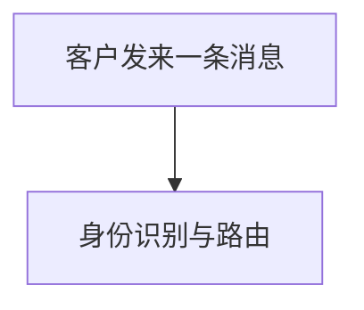

# 结构真相文件生成与写作规范

本附件约束 `pflow-init` 如何从通用骨架生成项目的 `ai/tech-design/`。真相文件只描述系统当前结构；模板见 `truth-doc-templates.md`。

## 1. 生成顺序

1. 识别项目边界、主要运行单元、稳定机制和真实源码目录。
2. 参考「类型侧重提示清单」拟定机制文档占位清单；按项目实况裁剪，不为凑齐类型条目建空文档。
3. 向用户展示拟建清单及每份文档的职责，确认增删后再创建文件。
4. 建立 `README.md` 门户、已确认的机制文档、`code-map.md`，并保持三处命名和链接一致。
5. 用具体项目事实替换全部占位符；删除模板说明、空章节和不适用示例。生成文件时先剥掉模板外层 `~~~markdown` 围栏——那层围栏只是附件用来展示模板的排版手段，写入的文件内容从模板正文本身开始（机制文档从 frontmatter 的 `---` 开始，门户 / code-map / 总表从 `# 标题` 开始）。

机制文档清单定义了真相体系的边界，属于用户确认项：初始化时的占位清单、历史项目的缺口清单，以及后续新增或建议删除机制文档，都要先确认。已有机制文档的常规内容回写无需逐条确认。

机制文档 frontmatter 中，`last_reviewed` 记录最近一次按当前源码完成复核的日期，不能用未实际复核的生成日期代替；每次收尾复核后刷新。`sources` 列出本文机制实际落点的仓库相对路径，供读者反查与校验件核对路径存活。

## 2. 一套骨架，按实况裁剪

所有项目使用同一套门户、机制文档和 code-map 骨架。项目类型只影响内容侧重，不产生多套结构。下列清单是**提示，不是强制要求**；混合型项目可合并参考，不适用项直接跳过。

| 项目类型 | 机制文档优先讲清 | 适合放入门户或速查表的内容 |
|---|---|---|
| CLI 工具 | 命令如何解析并路由、配置与环境变量如何合并、交互/非交互执行如何分流、失败如何映射为退出码 | 命令族与参数速查、退出码约定、输入输出与路径基准 |
| Web 应用 | 前后端边界、状态由谁持有与同步、请求/事件如何流转、并发写与重连如何处理、认证与权限在哪一层生效 | 状态管理机制图、前后端接口总表、并发/同步机制入口 |
| 库 / 包 | 公开 API 与内部实现边界、扩展点与生命周期、错误模型、版本升级时如何保持兼容 | 公开 API reference 入口、版本兼容策略、运行时与构建时依赖 |
| 数据管道 | 数据从来源到落点的分段流转、schema 在哪里校验和演进、重试/幂等/回放边界、失败数据如何隔离与恢复 | 数据流图、schema 演进机制、批次/检查点/质量指标速查 |
| 多端 / 多服务应用（桌面端+移动端+服务端、微服务、agent 系统等） | 端/服务之间的边界与通信契约、共享核心与端特有层如何划分、同一业务规则或状态在多端如何保持一致与同步、各端构建发布差异 | 系统级 Container 图（表达多端拓扑与通信方向）、端间接口契约总表、按端分域的编号段约定 |

具体选择示例：一个同时提供 CLI 的 Web 服务，不必创建两套文档；可用 `01-runtime.md` 讲进程与容器，用 `10-request-flow.md` 讲 Web 请求路径，用 `20-cli-commands.md` 讲命令族如何复用同一核心服务。

多端项目用编号分域按端分段：`01-topology.md` 讲整体拓扑与端间契约，`10-19` 服务端机制、`20-29` 桌面端、`30-39` 移动端；门户的 Container 图承担多端拓扑总览。真正的跨端机制（如多端状态同步、统一鉴权）单独成文，放在它主要归属的域段，其他端的机制文档链接过去，不各写一份。

「接口总表」「命令族速查」等 reference 型内容达到独立成篇规模时，落地为 `NN-<总表名>.md`（模板见 `truth-doc-templates.md` 第 4 节）；内容尚零散时先放进对应机制文档的表格，不必现开总表文件。

## 3. 文件职责与编号

| 文件 | 只负责 | 不承担 |
|---|---|---|
| `README.md` | 文件清单、阅读顺序、问题式路由、系统级 Context/Container 图 | 单个机制的完整流程、源码条目全集 |
| `NN-<机制名>.md` | 一个机制当前如何协作、边界和设计理由 | 函数签名抄录、阶段计划、跨机制杂记 |
| `NN-<总表名>.md`（按需） | 汇总一类成规模的稳定速查条目（如 API 端点、命令族）为分组表格 | 单条目的协作细节与设计理由、决策历史 |
| `code-map.md` | 模块地图、机制/概念到真实源文件的反查索引 | 机制的完整解释、决策历史 |

编号为稳定地址，不因新增文件重排：

| 号段 | 用途 | 示例 |
|---|---|---|
| `00` | 系统边界、外部依赖、不负责事项 | `00-boundary.md` |
| `01-09` | 跨领域骨架，如运行时拓扑、核心数据模型、共享约束 | `01-runtime.md`、`02-data-model.md` |
| `10+` | 按领域分段并预留号位 | `10-19` 写路径，`20-29` 认证，`30-39` 接口 |

新增机制时优先使用所属领域的空号位，例如已有 `10-write-path.md`、`12-retry.md` 时可增加 `11-concurrency.md`，不要为保持连续而重命名既有文件。号段按项目领域规划，不要求用满，也不要求所有项目采用相同领域分段。

## 4. 写作纪律

### 只写会改变读者行为的当前事实

真相文件只写：

- 现在是什么：边界、状态、数据和责任归属；
- 现在怎么协作：调用方向、运行顺序、失败与降级路径；
- 为什么这样设计：能帮助读者正确修改或排障的约束理由。

每句话都用以下判别测试：

> 这句话会改变一个第一次读它的读者的行为吗？不会 → 删。

应保留：`任务状态只由 Runner 推进；HTTP 与 CLI 都调用 Runner，避免两套重试规则造成重复执行。`

应删除：`我们最初考虑过让 HTTP 层直接重试，后来经过几轮讨论才改成现在这样。`

### 过程性内容禁入

| 不进入真相文件的内容 | 应放位置 |
|---|---|
| 阶段性思考、实现过程、当次排查流水 | 当前 sprint 的 `LOGBOOK.md` 或 `ai/scratch/` |
| 待办、延期项、未来可能做的增强 | `ai/ROADMAP.md` |
| 变更辩护、历史方案比较、为何推翻旧设计 | 当前 sprint 的 `LOGBOOK.md`，或 `ai/scratch/` 中的历史分析 |
| 临时实验、一次性命令输出、未验证猜测 | `ai/scratch/` |
| sprint 范围、步骤、进度与验收记录 | sprint 文件 |

历史信息只有在会改变当前操作时才保留为现行约束。例如不要写版本演进流水；应写 `旧格式仍可读但不再写出，迁移入口为 <路径>`。

### 篇幅分层控制

- 函数签名、类型字段、分支实现和逐行算法以源码为准，不在真相文件抄录；文档只给协作关系、关键不变量和源码入口。
- 路径、命令、端点、格式、状态枚举等速查内容使用表格，不用长段落堆叠。
- 一份机制文档只讲透一个机制；跨机制关系用链接，不复制另一份文档的正文。
- 单份真相文档超过 500 行时，由校验件 L6 给出黄灯；收到提示后拆分机制或提炼重复内容，不通过继续追加绕过告警。

## 5. 图规范

所有图使用 Mermaid 直接内嵌在 Markdown，不依赖外部绘图文件或专有工具。

### 按 C4 层级放图

| 位置 | 使用的 C4 词汇 | 应表达 | 不应表达 |
|---|---|---|---|
| `README.md` 门户 | Context / Container | 使用者、外部系统、系统边界、主要运行/部署容器及其关系；全目录只保留一张系统级图 | 函数、类、单机制分支与详细时序 |
| 机制文档 | Component / 时序图 | 参与该机制的组件职责、依赖方向；关键调用顺序、并发、重试、回滚 | 全系统模块全集、与本机制无关的组件 |
| 机制文档 | 状态机图（按需） | 单一实体的合法状态集合与迁移条件，及迁移如何影响正确性 | 与该实体无关的其他状态机、系统级架构 |
| 机制文档 | 数据模型图（按需） | 参与该机制的多个实体、字段与关联基数约束 | 全系统数据模型全集、与本机制无关的实体 |
| `code-map.md` | Component 模块地图 | 稳定源码责任块、依赖方向及源码范围 | 业务流程细节或历史架构 |
| 门户或拓扑/机制文档 | 业务视角图（按需，见下） | 一次业务旅程从触发到结果的流转、面向人的功能结构 | 代码模块细节、函数级实现 |

这里的 C4 词汇用于约束观察层级，不要求引入 C4 专用 Mermaid 语法。用 `flowchart` 或 `sequenceDiagram` 即可，但同一张图只回答一个层级的问题。

### 业务视角图

面向人建立业务理解的图（业务流程、功能结构、分层总览），节点用业务语言（如「客户发来消息」「生成澄清问题」），**不要求对齐 code-map 条目名**。同样用 Mermaid 内嵌，图内第一行写标记注释 `%% 业务视角` 声明身份，校验件 L4 会跳过带标记的图：

~~~markdown

~~~

约束：业务视角图与技术图讲不同的话，不混在一张图里；同一业务概念在多张业务视角图之间保持同名；描述系统当前真实行为，与其他真相内容一样随机制变化回写。

### 节点名必须可校验

图中项目内部节点和时序参与者的**显示名称**必须与 `code-map.md` 的「机制/概念」或模块条目名完全一致，使校验器能够比对。不要在不同文件中混用简称、目录名和产品昵称。

校验件 L4 目前仅比对 `flowchart` 与 `sequenceDiagram` 的节点名；状态机图、数据模型图的命名对齐是规范约定，校验器暂不比对，仍需人工核对。

正确示例：

```markdown
code-map 条目：`任务运行器`
图节点：RUNNER["任务运行器"]
时序参与者：participant RUNNER as 任务运行器
```

错误示例：同一组件在门户写 `Runner`、机制图写 `任务执行器`、code-map 写 `JobRunner`。若需要补充说明，把说明放在连线上、图下正文或 code-map 的职责列，不改稳定节点名。

外部角色和外部系统不要求登记为源码条目；应使用清楚且稳定的名称，并避免与内部条目重名。

## 6. 交付前自检

- [ ] `README.md` 同时包含文件清单、阅读顺序、问题式路由表和一张系统级 Context/Container 图。
- [ ] `code-map.md` 同时包含 Mermaid 模块地图与「机制/概念 → 源文件」反查表，路径相对仓库根目录。
- [ ] 每份机制文档 frontmatter 都有有效日期 `last_reviewed` 与至少一个真实 `sources` 路径。
- [ ] 每份机制文档只讲一个机制的协作关系、边界、理由和必要时序，不抄函数签名。
- [ ] 文件编号符合 `00`、`01-09`、`10+` 约定，新增文件未导致旧文件重排。
- [ ] 类型侧重已按项目实况裁剪，没有为满足提示清单创建空文档。
- [ ] 速查总表（如有）仅在对应速查内容成规模时创建；未成规模的零散速查项并入机制文档表格，没有为凑类型而空立总表文件。
- [ ] 图使用 Mermaid 内嵌；门户放系统级图，机制文档放机制级图。
- [ ] 所有内部图节点名与 `code-map.md` 条目名完全一致。
- [ ] 没有阶段性思考、待办、变更辩护或历史流水进入真相文件。
- [ ] 所有占位符、模板说明和空章节已删除；超过 500 行的机制文档已拆分或提炼。
