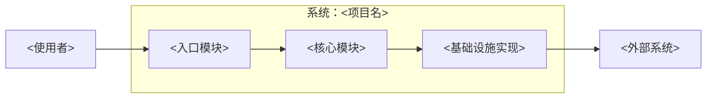
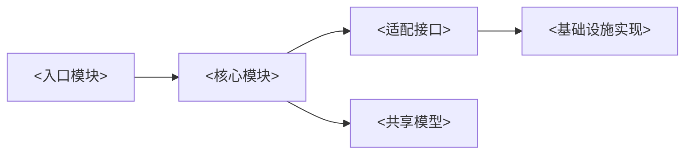
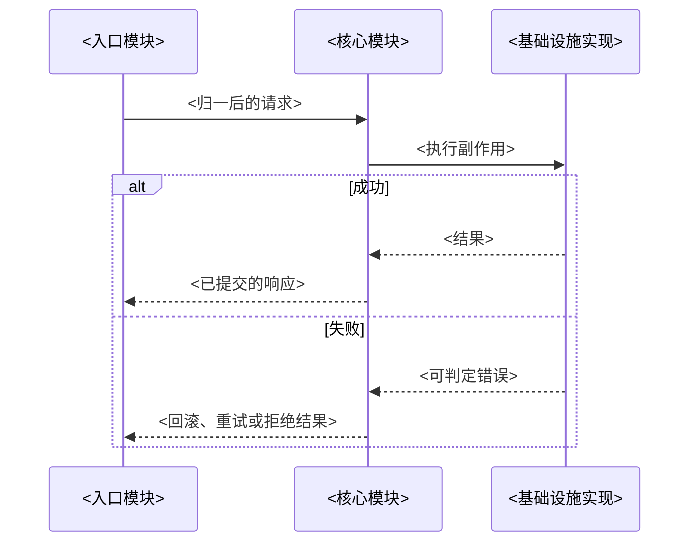

# 结构真相文件骨架模板

本附件供 `pflow-init` 生成 `ai/tech-design/` 使用。先依据 `truth-doc-guidelines.md` 拟定机制文档清单并取得用户确认，再替换模板中的尖括号占位符；删除不适用的段落，不保留空标题或模板说明。

下列每份模板都用外层 `~~~markdown` 围栏包裹——这层围栏只是本附件用来展示模板的排版手段，**不是生成文件的一部分**。生成实际文件时先剥掉外层 `~~~` 围栏，写入的文件内容从模板正文本身开始（机制文档从 frontmatter 的 `---` 开始，门户 / code-map / 总表从 `# 标题` 开始）。

## 1. 门户 `README.md`

~~~markdown
# <项目名> 结构真相门户

本目录描述系统当前的边界、模块协作和源码落点。第一次接手时先按「阅读顺序」建立全局认识；处理具体问题时直接使用「问题式路由表」，无需通读全部文档。函数签名与实现细节以源码为准。

> 路径基准：本文档集中的源码路径均相对仓库根目录。

## 阅读顺序

1. 读 [00-<边界文档名>.md](00-<边界文档名>.md)，确认系统边界、外部依赖和明确不负责的事项。
2. 读 `01-09` 中与当前任务有关的骨架文档，例如运行时拓扑、核心数据模型或共享约束。
3. 按下方「问题式路由表」跳到单一机制文档；不要按编号顺序通读所有文件。
4. 需要从机制反查改动落点时，读 [code-map.md](code-map.md)。

## 系统级结构图

本门户只放一张系统级 **Context/Container** 图：画出使用者、外部系统、系统边界和主要容器，不展开函数、类或单一机制时序。项目内部节点的显示名称必须与 [code-map.md](code-map.md) 的条目名完全一致。



图下用一段话说明最重要的边界判断，例如：`<入口模块>` 只负责输入归一与调用编排，业务规则集中在 `<核心模块>`；`<外部系统>` 不可用时 `<基础设施实现>` 采用 `<失败或降级策略>`。

## 文件清单

| 文件 | 职责 | 什么时候读 |
|---|---|---|
| [00-<边界文档名>.md](00-<边界文档名>.md) | 系统边界、外部依赖、明确不负责的事项 | 第一次接手或判断改动是否越界时 |
| [01-<骨架机制名>.md](01-<骨架机制名>.md) | <跨领域骨架机制及其关键协作关系> | <典型问题，例如启动、数据模型或共享约束> |
| [10-<领域机制名>.md](10-<领域机制名>.md) | <一个领域机制的当前运作方式> | <修改该机制或排查其失败路径时> |
| [code-map.md](code-map.md) | 模块地图与机制/概念到源码的反查索引 | 已知问题概念、需要定位源文件时 |

## 问题式路由表

问题要写成第一次接手者会实际提出的句子；答案优先指向讲透该问题的单一文件，确有跨机制关系时才列两个入口。

| 我想搞清… | 读哪个文件 |
|---|---|
| 系统负责什么、不负责什么，依赖缺失时会怎样 | [00-<边界文档名>.md](00-<边界文档名>.md) |
| 一次 `<典型操作>` 从入口到落盘经过哪些模块 | [10-<领域机制名>.md](10-<领域机制名>.md) |
| `<关键状态>` 由谁持有，何时创建、更新和失效 | [NN-<对应机制名>.md](NN-<对应机制名>.md) |
| 两个调用方同时修改 `<共享资源>` 时如何避免覆盖 | [NN-<并发机制名>.md](NN-<并发机制名>.md) |
| 某个机制或概念对应哪些真实源文件 | [code-map.md](code-map.md) |
~~~

## 2. 代码地图 `code-map.md`

~~~markdown
# 代码地图

本文件提供两种导航：先用模块地图理解源码责任块及依赖方向，再用「机制/概念 → 源文件」表定位改动入口。路径均相对仓库根目录，并应指向已纳入版本控制的文件或目录。

## 模块地图

这张图只表达稳定的源码模块边界和依赖方向，不重复门户中的系统 Context/Container 图，也不展开某个机制的运行时序。节点显示名称必须与本文件下方反查表中的条目名完全一致。



| 图节点名 | C4 词汇 | 源码范围 | 职责与依赖约束 |
|---|---|---|---|
| `<入口模块>` | Component | `src/<入口目录>/` | 接收 `<输入>`、完成归一后调用 `<核心模块>`；不持有业务规则 |
| `<核心模块>` | Component | `src/<核心目录>/` | 执行 `<核心规则>`；只依赖 `<适配接口>` 和 `<共享模型>` |
| `<适配接口>` | Component | `src/<接口文件>` | 隔离 `<外部能力>`；接口契约的源码入口 |
| `<基础设施实现>` | Component | `src/<实现目录>/` | 实现 `<适配接口>`，负责 `<存储、网络或进程能力>` |
| `<共享模型>` | Component | `src/<模型目录>/` | 定义跨模块共享的数据约束 |

## 机制/概念 → 源文件

一行对应一个可搜索、可复核的机制或概念。先写读者会搜索的稳定名称，再列完整源码落点；同一机制跨文件协作时在同一行列全，不抄函数签名。

| 机制 / 概念 | 源文件 | 对应机制文档 |
|---|---|---|
| `<配置加载>` / `<默认值合并>` / `<启动校验>` | `src/config/load.ts` · `src/config/schema.ts` | [NN-<配置机制>.md](NN-<配置机制>.md) |
| `<任务提交>` / `<串行执行>` / `<失败重试>` | `src/jobs/submit.ts` · `src/jobs/runner.ts` | [NN-<任务机制>.md](NN-<任务机制>.md) |
| `<入口模块>` | `src/<入口目录>/` | [01-<骨架机制名>.md](01-<骨架机制名>.md) |
| `<核心模块>` | `src/<核心目录>/` | [01-<骨架机制名>.md](01-<骨架机制名>.md) |
| `<适配接口>` | `src/<接口文件>` | [NN-<适配机制名>.md](NN-<适配机制名>.md) |
| `<基础设施实现>` | `src/<实现目录>/` | [NN-<适配机制名>.md](NN-<适配机制名>.md) |
| `<共享模型>` | `src/<模型目录>/` | [NN-<数据机制名>.md](NN-<数据机制名>.md) |
~~~

## 3. 机制文档 `NN-<机制名>.md`

~~~markdown
---
last_reviewed: YYYY-MM-DD
sources:
  - src/<机制入口文件>
  - src/<关键协作文件>
---

# <机制名>

<用两三句话说明该机制现在解决什么问题、从什么输入得到什么结果，以及最重要的边界。只描述当前事实。>

## 边界与职责

| 项目 | 当前约定 |
|---|---|
| 负责 | <该机制拥有的状态、规则或流程> |
| 不负责 | <由其他机制承担、容易被误放进来的职责> |
| 输入 | <来自哪个模块的事件、数据或调用> |
| 输出 | <交给哪个模块的结果、状态或副作用> |
| 失败取向 | <失败时回滚、重试、降级、拒绝或保留何种状态> |

## 协作关系

先讲模块之间如何分工，再讲为什么这样切分。组件名称使用 [code-map.md](code-map.md) 中的稳定条目名。

| 组件 | 在本机制中的职责 | 为什么由它负责 |
|---|---|---|
| `<入口模块>` | 校验并归一 `<输入>`，发起一次机制调用 | 避免传输或界面约束渗入核心规则 |
| `<核心模块>` | 决定 `<关键状态变化>` | 保证所有入口复用同一套规则 |
| `<基础设施实现>` | 执行 `<外部副作用>` 并返回可判定结果 | 把网络、存储或进程差异隔离在边界外 |

### Component 图

静态协作关系不够直观时，在这里放机制级 **Component** 图；只画参与本机制的组件。节点显示名称必须与 `code-map.md` 条目名完全一致。


## 运行流程

1. `<入口模块>` 接收 `<具体触发，例如一次命令、请求或消息>`，完成 `<边界校验>`。
2. `<核心模块>` 根据 `<当前状态或不变量>` 决定 `<状态变化>`。
3. `<基础设施实现>` 执行 `<可观察副作用>`，返回 `<成功或失败结果>`。
4. `<核心模块>` 在 `<成功条件>` 下提交结果；在 `<失败条件>` 下执行 `<回滚、重试或降级>`。

### 关键时序图

当先后顺序、并发、重试或回滚会影响正确性时，在这里放机制级时序图；没有时序约束时删除本小节。参与者名称必须与 `code-map.md` 条目名完全一致。



## 状态与结构（按需）

机制若有多状态实体或多实体关联，在这里补图；只是单一线性流程或扁平数据结构时整节删除。

### 状态机图

适用：`<实体>` 有多个状态，且状态迁移规则本身会影响正确性（不只是运行流程的中间步骤）。仅是运行流程的顺序展开时改放上方「关键时序图」，不建状态机图。状态名与转移条件使用的实体名称须与 `code-map.md` 条目名一致。

```mermaid
stateDiagram-v2
    [*] --> <初始状态>
    <初始状态> --> <推进状态>: <触发条件>
    <推进状态> --> <终态>: <成功条件>
    <推进状态> --> <初始状态>: <失败或回滚条件>
```



### 数据模型图

适用：机制涉及多个实体的关联关系与约束（层级、外键、基数），单一扁平结构用「边界与职责」或字段表即可，不建此图。类间协作关系用 `classDiagram`，重存储关联基数用 `erDiagram`；实体名须与 `code-map.md` 条目名一致。

```mermaid
classDiagram
    class <实体A> {
        +<字段>: <类型>
    }
    class <实体B> {
        +<字段>: <类型>
    }
    <实体A> "1" --> "n" <实体B> : <关系>
```

## 关键约束与理由

| 约束 | 为什么 | 违反时的可观察后果 |
|---|---|---|
| `<状态只能由核心模块推进>` | `<多个入口必须共享同一套一致性规则>` | `<出现覆盖、重复执行或状态分叉>` |
| `<外部副作用必须返回可判定结果>` | `<核心模块需要决定提交还是补偿>` | `<失败后无法判断真实状态>` |

## 源码入口

具体函数签名、类型字段与分支实现以源码为准，本文只保留定位入口。

| 阅读目的 | 源文件 |
|---|---|
| 理解机制入口与核心规则 | `src/<机制入口文件>` |
| 理解状态持有与不变量 | `src/<状态文件>` |
| 理解外部副作用与失败映射 | `src/<适配实现文件>` |

## 相关真相

- 代码反查：[code-map.md](code-map.md)
- 上下游机制：[NN-<相关机制>.md](NN-<相关机制>.md)
- 当前设计的决策依据：[`ai/specs/<相关定稿-spec>.md`](../specs/<相关定稿-spec>.md)
~~~

## 4. 速查总表 `NN-<总表名>.md`

reference 型速查内容成规模后才新建（如端点数或命令数已经撑满一份机制文档的篇幅）；零散的几条速查项直接放进对应机制文档的表格即可，不必现开总表文件。

~~~markdown
---
last_reviewed: YYYY-MM-DD
sources:
  - src/<入口文件或目录>
---

# <总表名，例如「服务端 API 总表」「CLI 命令族速查」>

<一两句话说明本表覆盖哪一类稳定的速查条目，以及为何从各机制文档中独立汇总，避免重复维护。>

## 通用约定

<跨条目共享、不必逐行重复的规则，例如统一错误码、鉴权方式、响应体格式。>

| 项目 | 约定 |
|---|---|
| `<共享规则维度，例如响应体格式>` | `<约定内容>` |

## <分组名，例如「读路径」>

| 端点 | 方法 | 职责 | 源文件 |
|---|---|---|---|
| `<路径>` | `<GET / POST / …>` | `<一句话职责>` | `<源码相对路径>` |

## <分组名，例如「<命令族名>」>

| 命令 | 职责 | 源文件 |
|---|---|---|
| `<命令名及关键参数>` | `<一句话职责>` | `<源码相对路径>` |
~~~
